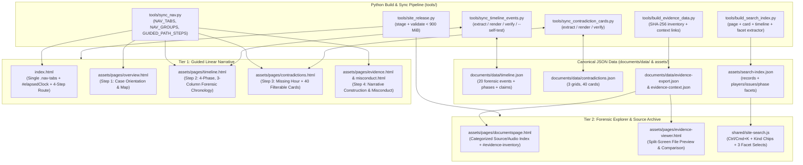

# Two-Tier Information Architecture, Forensic Timeline, and Contradiction Hub Restructure

*   **Author:** allenbenj
*   **Status:** Approved
*   **Date:** 2026-11-01

--------------------------------------------------------------------------------

## Overview

"An Edifice of Lies" (*State v. Benjamin Allen*) is a static legal-advocacy website hosted on GitHub Pages that documents evidentiary contradictions, investigative failures, and official misconduct through primary court filings, surveillance video clips, and recorded police interviews.

This design restructures the site around a two-tier information architecture while preserving the existing dark charcoal, teal, and gold visual palette (`#111415` background, `#2c5a61` / `#a6ced2` teal accents, `#d4b85c` gold highlights), the Lady Justice hero graphic, and the live `#elapsedClock` arrest timer on [`index.html`](file:///D:/web_page/pages-main/index.html):

1.  **Tier 1 — Guided Linear Path for First-Time Visitors:** Removes the duplicate legacy Webflow navigation bar on [`index.html`](file:///D:/web_page/pages-main/index.html) and introduces a 4-step reading progression (`Overview & Seven Factors` → `Forensic Timeline` → `Contradictions Hub` → `Evidence & Misconduct`) supported by a shared static progression bar across those core pages.
2.  **Tier 2 — Forensic Cross-Reference & Source Archive for Researchers:** Replaces the zig-zag graphic-stamp layout on [`assets/pages/timeline.html`](file:///D:/web_page/pages-main/assets/pages/timeline.html) with a 4-phase, 3-column forensic chronology (`Timestamp & Exhibit` | `Surveillance Video & Factual Record` | `Contradicted Testimony/Claim in HTML Text`); consolidates all 40 contradiction, forensic, and interview-audio cards onto [`assets/pages/contradictions.html`](file:///D:/web_page/pages-main/assets/pages/contradictions.html); refocuses [`assets/pages/documentspage.html`](file:///D:/web_page/pages-main/assets/pages/documentspage.html) as the primary document and audio archive index; and upgrades site search and the evidence viewer with facet filtering by witness/player, legal issue, timeline phase, and media type.

## The Problem

Visitors arriving at the site today encounter four structural barriers that prevent both quick orientation and deep evidentiary lookup:

1.  **Competing Navigation Bars on the Landing Page:** [`index.html`](file:///D:/web_page/pages-main/index.html) renders two stacked top navigation bars: the shared project navigation bar (`.home-nav-shell > .nav-tabs` at lines 38–89) immediately above a leftover Webflow mega-menu (`.nav` at lines 90–185). These two menus use conflicting labels for the same destinations (`Case Record` vs. `Framework`, `Evidence` vs. `Evidence Record`) and expose 20 pages across four dropdowns without telling a new reader where to begin.
2.  **Low-Credibility Zig-Zag Timeline Layout:** [`assets/pages/timeline.html`](file:///D:/web_page/pages-main/assets/pages/timeline.html) alternates events left and right across a center spine (`timeline-pair` / `timeline-pair reverse`), placing a decorative `False.webp` image (`.liar-stamp`) in the center and a rasterized text-box graphic (`.hug-lie-image`) on the opposite side. Readers must scan back and forth to determine which side is the timestamped camera record and which side is the contradicted claim. Because the contradicted statements are locked inside flat `.webp` images, they cannot reflow on mobile screens (`<= 900px`), cannot be read by screen readers, and cannot be indexed as HTML text by site search. In addition, Event 05 (`12:41 AM — Love & Morrison leave Schooly's`, line 148) reuses the wrong graphic file (`Peter_West_Leaves_Alone.webp`, copied from the `12:35 AM` event).
3.  **Misplaced Contradiction Cards and Uncontrolled Audio Load:** The site's 40 structured contradiction, forensic, and interview-audio cards live inside [`assets/pages/documentspage.html`](file:///D:/web_page/pages-main/assets/pages/documentspage.html) (labeled "Documents" in the navigation bar and "State v. Benjamin Allen - Catch All" in the `<title>` tag) rather than on [`assets/pages/contradictions.html`](file:///D:/web_page/pages-main/assets/pages/contradictions.html). Visitors clicking "Contradictions" see only the "Missing Hour" narrative and miss the 40 impeachment cards, while visitors clicking "Documents" must scroll past 1,300 lines of contradiction cards before reaching the `#evidence-inventory` file table.
4.  **Coarse Search Filtering:** [`shared/site-search.js`](file:///D:/web_page/pages-main/shared/site-search.js) and [`tools/build_search_index.py`](file:///D:/web_page/pages-main/tools/build_search_index.py) only filter results by broad format (`page`, `pdf`, `media`, `image`). An attorney, journalist, or investigator cannot filter the record by a specific witness (such as `Carmen Love` or `Steve Freeman`), legal issue (such as `Timeline Contradiction` or `Warrantless Arrest`), or phase of the night.

## Goals

*   **Single Navigation & Guided 4-Step Reading Path:** Remove the duplicate `<div class="nav">` block from [`index.html`](file:///D:/web_page/pages-main/index.html) while preserving `#elapsedClock` and the Lady Justice hero panel, and provide a shared static `.guided-path-bar` across the four primary orientation pages (`overview.html`, `timeline.html`, `contradictions.html`, `evidence.html`) generated idempotently by [`tools/sync_nav.py`](file:///D:/web_page/pages-main/tools/sync_nav.py).
*   **Text-First 3-Column Forensic Chronology on `timeline.html`:** Replace the zig-zag `.liar-stamp` layout with 4 chronological phases of the night and 20 `<article class="timeline-event">` rows containing three ordered child columns (`Timestamp & Exhibit` | `Surveillance Video & Factual Record` | `Contradicted Claim HTML Text + Secondary Graphic Modal Button`), fixing the `12:41 AM` wrong graphic reference and maintaining round-trip verification with [`tools/sync_timeline_events.py`](file:///D:/web_page/pages-main/tools/sync_timeline_events.py) and [`documents/data/timeline.json`](file:///D:/web_page/pages-main/documents/data/timeline.json).
*   **Unified Contradictions Hub & Dedicated Document Archive:** Migrate all 40 contradiction, forensic, and interview-audio cards plus the single `#card-controls` filter toolbar from [`assets/pages/documentspage.html`](file:///D:/web_page/pages-main/assets/pages/documentspage.html) to [`assets/pages/contradictions.html`](file:///D:/web_page/pages-main/assets/pages/contradictions.html), rewrite all 11 internal `.matrix-card` links to `contradictions.html?q=...`, add `documentspage.html?q=...` redirect forwarding, update [`documents/data/evidence-context.json`](file:///D:/web_page/pages-main/documents/data/evidence-context.json) and [`documents/data/evidence-export.json`](file:///D:/web_page/pages-main/documents/data/evidence-export.json), and retarget [`tools/sync_contradiction_cards.py`](file:///D:/web_page/pages-main/tools/sync_contradiction_cards.py).
*   **Zero Upfront Media Bandwidth on Page Load (`preload="none"`):** Enforce `preload="none"` and a single-active-player pause rule across all 14 linked surveillance video clips (`Exhibits A–I, L, M, O, P, and Q`) on [`timeline.html`](file:///D:/web_page/pages-main/assets/pages/timeline.html) and all 45+ embedded `<audio>` players on [`contradictions.html`](file:///D:/web_page/pages-main/assets/pages/contradictions.html) and [`documentspage.html`](file:///D:/web_page/pages-main/assets/pages/documentspage.html).
*   **Faceted Search & Evidence Filtering:** Enrich [`assets/search-index.json`](file:///D:/web_page/pages-main/assets/search-index.json) via [`tools/build_search_index.py`](file:///D:/web_page/pages-main/tools/build_search_index.py) with `players`, `issues`, and `phase` facets, and expose three compact `<select>` filter dropdowns (`Player`, `Issue`, `Timeline Phase`) in [`shared/site-search.js`](file:///D:/web_page/pages-main/shared/site-search.js) and [`shared/evidence-viewer.js`](file:///D:/web_page/pages-main/shared/evidence-viewer.js).
*   **100% Release Gate Compliance:** Pass `tools/site_release.py stage` and `validate` with zero broken internal references, zero forbidden paths, and total artifact size under `900 MiB` (`943,718,400` bytes; currently `~680 MiB`).

## Non-Goals

*   Altering any factual claims, witness quotes, dates, timestamps, exhibit designations (`Exhibit A`–`Exhibit Q`), or legal citations.
*   Introducing a JavaScript framework, bundler, or build step (such as React or Vite) to the canonical HTML pages in `assets/pages/`.
*   Deleting canonical HTML filenames under `assets/pages/` that external links or bookmarks may reference.
*   Using `localStorage` or session state to track guided-tour reading progress.
*   Re-encoding or modifying original evidence master files in `archive/evidence-masters/`, `video/`, `audio/`, or `documents/`.

## Open Questions

*   None. All architectural, tooling, layout, and media-loading questions were resolved during the brainstorm phase.

## Critical User Journeys (CUJs)

### CUJ 1: First-Time Visitor Follows the Guided Linear Narrative

*   **Given**: A first-time visitor lands on [`index.html`](file:///D:/web_page/pages-main/index.html) on desktop or mobile (`<= 900px`).
*   **When**: The visitor views the hero section with the `#elapsedClock` arrest timer, reads the Seven Factors overview, and clicks into the 4-step Guided Reading Path (`Step 1: Overview & Players` → `Step 2: Forensic Timeline` → `Step 3: Contradictions Hub` → `Step 4: Evidence & Misconduct`).
*   **Then**: Only one top navigation bar (`.nav-tabs`) is rendered on [`index.html`](file:///D:/web_page/pages-main/index.html); each core page displays the static `.guided-path-bar` highlighting the current step via URL match (`aria-current="step"`) with working previous/next step links.

### CUJ 2: Reviewing Surveillance Video vs. Contradicted Testimony on the Timeline

*   **Given**: A visitor opens [`timeline.html`](file:///D:/web_page/pages-main/assets/pages/timeline.html) to inspect the chronology of October 18–19, 2019.
*   **When**: The visitor clicks a phase chip in the sticky `.page-rail` (e.g., `Phase II: 12:41 AM–12:54 AM`), reads a 3-column `.timeline-event` row comparing the surveillance record against the HTML text of the contradicted claim, and clicks "Play Inline" on `Exhibit H`.
*   **Then**: Zero video bytes were fetched prior to the click (`preload="none"`); clicking "Play Inline" loads and plays `video/H Still Arguing Lauren Hugs Allen And He Keeps His Hands In His Pocket Compressed.mp4` inline (pausing any other playing clip); on viewports `<= 900px`, the row stacks vertically as `Timestamp & Exhibit → Surveillance Record → Contradicted Claim HTML`.

### CUJ 3: Auditing Contradictions and Playing Impeaching Interview Audio

*   **Given**: A researcher opens [`contradictions.html`](file:///D:/web_page/pages-main/assets/pages/contradictions.html) (either directly from the navigation bar or via an old `documentspage.html?q=...` link that automatically forwards to `contradictions.html?q=...`).
*   **When**: The researcher uses `#card-controls` to filter the 40 contradiction cards by category or search term and clicks play on an embedded `<audio preload="none">` excerpt from Carmen Love's or Lauren Deal's police interview.
*   **Then**: The matching contradiction card highlights and plays the audio clip on demand (automatically pausing any other active `<audio>` or `<video>` element on the page), and clicking a cross-link from a `.matrix-card` resolves to `contradictions.html?q=...`.

### CUJ 4: Faceted Lookup Across Witnesses, Issues, and Timeline Phases

*   **Given**: An attorney or investigator opens the global search overlay (`Ctrl/Cmd+K` via [`shared/site-search.js`](file:///D:/web_page/pages-main/shared/site-search.js)) or [`evidence-viewer.html`](file:///D:/web_page/pages-main/assets/pages/evidence-viewer.html).
*   **When**: The user selects `Player: Carmen Love` and `Issue: Timeline Contradiction` from the facet `<select>` dropdowns.
*   **Then**: The results immediately narrow to matching pages, individual contradiction cards on `contradictions.html`, timeline events on `timeline.html`, and audio/document files without requiring exact filename recall.

## Technical Plan (Architecture)

### 1. System Data Flow & Two-Tier Architecture

The repository remains a static HTML5/CSS3/vanilla-JS site with Python 3.11+ maintenance and release-validation tools in `tools/`. All structural synchronization happens deterministically at author/build time via the Python tools so that the deployed GitHub Pages artifact requires zero server runtime and zero client-side framework bundles on canonical pages.



### 2. Unified Navigation & Static Guided-Path Bar (`index.html` & `tools/sync_nav.py`)

*   **Removing Duplicate Navigation on [`index.html`](file:///D:/web_page/pages-main/index.html):**
    *   Delete the legacy Webflow `<div class="nav">...</div>` block at lines 90–185 of [`index.html`](file:///D:/web_page/pages-main/index.html#L90-L185).
    *   Retain `<div class="home-nav-shell"><div class="nav-tabs" aria-label="Project navigation">...</div></div>` (delimited by `<!-- PROJECT_NAV_START -->` and `<!-- PROJECT_NAV_END -->`) as the single navigation header on [`index.html`](file:///D:/web_page/pages-main/index.html#L38-L89).
    *   Preserve `<header class="section">` containing `.hero-overlay`, `InJustice_80_percent.webp`, `#elapsedClock` (lines 187–254), and `#seven-factors` (lines 256–272).
    *   Expand `<nav class="reader-routes" aria-label="Reading routes">` (lines 274–281) into a 4-card **Guided Reading Path** (`01 Case Overview & Players` → [`overview.html`](file:///D:/web_page/pages-main/assets/pages/overview.html), `02 Forensic Timeline` → [`timeline.html`](file:///D:/web_page/pages-main/assets/pages/timeline.html), `03 Contradictions Hub` → [`contradictions.html`](file:///D:/web_page/pages-main/assets/pages/contradictions.html), `04 Evidence & Misconduct` → [`evidence.html`](file:///D:/web_page/pages-main/assets/pages/evidence.html)) followed by a compact **Direct Archive Access** strip linking to [`evidence-viewer.html`](file:///D:/web_page/pages-main/assets/pages/evidence-viewer.html), [`documentspage.html`](file:///D:/web_page/pages-main/assets/pages/documentspage.html), and [`connections.html`](file:///D:/web_page/pages-main/assets/pages/connections.html).
*   **Static `.guided-path-bar` Ownership in [`tools/sync_nav.py`](file:///D:/web_page/pages-main/tools/sync_nav.py):**
    *   Define `GUIDED_PATH_STEPS: list[tuple[str, str, str]]` in [`tools/sync_nav.py`](file:///D:/web_page/pages-main/tools/sync_nav.py):
        1. `("overview.html", "Step 1", "Overview & Players")`
        2. `("timeline.html", "Step 2", "Forensic Timeline")`
        3. `("contradictions.html", "Step 3", "Contradictions Hub")`
        4. `("evidence.html", "Step 4", "Evidence & Misconduct")`
    *   Add `render_guided_path(page_name: str) -> str` in [`tools/sync_nav.py`](file:///D:/web_page/pages-main/tools/sync_nav.py) that outputs a static `<nav class="guided-path-bar" aria-label="Guided reading path">` block wrapped in `<!-- GUIDED_PATH_START -->...<!-- GUIDED_PATH_END -->` markers on those four pages.
    *   The active step is marked statically via URL match (`class="guided-step active" aria-current="step"`), with `← Previous Step` and `Next Step →` links. No `localStorage` or client-side state is used, and `.guided-path-bar` uses static positioning (`position: relative`) so it never collides with the sticky `.page-rail` bar.

### 3. Forensic Chronology Architecture & Sync Contract (`assets/pages/timeline.html` & `tools/sync_timeline_events.py`)

*   **DOM Contract Inside `<div class="timeline-events">`:**
    *   The outer synced container remains `<div class="timeline-events">` so `find_container_span()` in [`tools/sync_timeline_events.py`](file:///D:/web_page/pages-main/tools/sync_timeline_events.py#L37-L52) works without changing its container-boundary regex.
    *   The 20 events are grouped into 4 chronological `<section class="timeline-phase" id="phase-1..4">` sections:
        *   `#phase-1`: **Phase I — Early Evening & Bar Arrival (6:30 PM – 12:35 AM)** (Events 01–04)
        *   `#phase-2`: **Phase II — Initial Contact & Keys Dispute (12:41 AM – 12:54 AM)** (Events 05–10)
        *   `#phase-3`: **Phase III — Escalation Inside & Outside Schooly's (1:12 AM – 2:04 AM)** (Events 11–17)
        *   `#phase-4`: **Phase IV — Departure, Missing Hour & Hospital Arrival (2:20 AM – 3:45 AM)** (Events 18–20)
    *   Each event row is an `<article class="timeline-event" id="event-XX" data-phase="phase-N" data-exhibit="X">` containing three ordered child `<div>` columns:

```text
<article class="timeline-event" id="event-08" data-phase="phase-2" data-exhibit="H">
  <!-- Column 1: Timestamp & Exhibit -->
  <div class="event-meta">
    <div class="event-time">Oct 19 2019 12:54</div>
    <span class="event-exhibit">Exhibit H</span>
  </div>

  <!-- Column 2: Surveillance / Factual Record (Teal Accent) -->
  <div class="event-record">
    <div class="event-record-kicker">Surveillance / Objective Record</div>
    <div class="event-description">
      Deal hugs Allen but it isn't returned. Allen keeps his hands in his pocket.
      <div class="event-video-actions">
        <button type="button" class="inline-video-btn" data-inline-video="video/H Still Arguing Lauren Hugs Allen And He Keeps His Hands In His Pocket Compressed.mp4">▶ Play Inline</button>
        <a class="video-btn" data-exhibit="H" data-modal-image="video/H Still Arguing Lauren Hugs Allen And He Keeps His Hands In His Pocket Compressed.mp4">WATCH VIDEO</a>
      </div>
    </div>
    <div class="event-inline-player" hidden></div>
  </div>

  <!-- Column 3: Contradicted Claim / Testimony (Amber/Crimson Callout) -->
  <div class="event-claim">
    <div class="event-claim-kicker">Contradicted Claim / Testimony</div>
    <div class="event-claim-body">
      <p><strong>Trial Testimony:</strong> Deal claimed a warm, mutual greeting and friendly rapport throughout the night. Surveillance shows she initiated an unreturned hug at 12:54 AM while arguing with Allen, who kept both hands in his pockets.</p>
    </div>
    <button type="button" class="graphic-btn" data-modal-image="content/images/evidence/graphics/inserts/hug_lie_comes_back.webp">View Graphic Insert</button>
  </div>
</article>
```

*   **Defect Fix on Event 05 (`12:41 AM — Love & Morrison leave Schooly's`):**
    *   Event 05 currently points its graphic insert to `content/images/evidence/graphics/inserts/Peter_West_Leaves_Alone.webp` (copied from Event 04 at `12:35 AM`). In the new 3-column row for Event 05, `.event-claim-body` states the exact contradiction in HTML text (Deal testified she stayed with Allen's group until 2:00 AM closing and told Carmen she was going to a bonfire before Carmen left; surveillance shows Carmen Love and James Morrison walking out at 12:41 AM without ever speaking to Allen or his friends), and omits the duplicate `Peter_West_Leaves_Alone.webp` reference on Event 05 (while Event 04 retains `Peter_West_Leaves_Alone.webp`).
*   **Extended Schema in [`tools/sync_timeline_events.py`](file:///D:/web_page/pages-main/tools/sync_timeline_events.py) & `--self-test` Mode:**
    *   Update `event_metadata(inner_html: str)` so each event record in [`documents/data/timeline.json`](file:///D:/web_page/pages-main/documents/data/timeline.json) records:
        *   `id`: `"event-01"` .. `"event-20"`
        *   `phase`: `node.get("data-phase")`
        *   `exhibit`: `node.get("data-exhibit")` (or `.video-btn[data-exhibit]`)
        *   `standalone`: `bool` (`node.select_one(".event-claim")` is `None`)
        *   `time`: `.event-time` text
        *   `description`: `.event-description` text (excluding `.event-video-actions` button labels)
        *   `video`: `.video-btn[data-modal-image]`
        *   `claimHtml`: inner HTML of `.event-claim-body` (or `None` for standalone events)
        *   `insertGraphic`: `.graphic-btn[data-modal-image]` (or `None`)
    *   Add a `--self-test` CLI flag to [`tools/sync_timeline_events.py`](file:///D:/web_page/pages-main/tools/sync_timeline_events.py) that parses an embedded 3-column `<article class="timeline-event">` fixture and verifies that `find_container_span()` and `event_metadata()` extract all fields without error before `timeline.html` is modified.
*   **Responsive Stacking & Sticky Sub-Navigation:**
    *   Desktop (`> 900px`): `grid-template-columns: 190px minmax(0, 1.15fr) minmax(0, 1fr)`.
    *   Mobile (`<= 900px`): `grid-template-columns: 1fr`, stacking `.event-meta` (1st) → `.event-record` (2nd) → `.event-claim` (3rd).
    *   Sticky bar rule: `.page-rail` (with links to `#phase-1`, `#phase-2`, `#phase-3`, `#phase-4`, `#event-0158`, `#event-0204`) is sticky; `.guided-path-bar` is static.

### 4. Contradiction Hub vs. Document Archive Split (`contradictions.html`, `documentspage.html`, `sync_contradiction_cards.py`)

*   **Migrating the 40 Cards and Filter Toolbar to [`assets/pages/contradictions.html`](file:///D:/web_page/pages-main/assets/pages/contradictions.html):**
    *   [`assets/pages/contradictions.html`](file:///D:/web_page/pages-main/assets/pages/contradictions.html) becomes the unified **Contradictions Hub** structured into two parts reachable from `.page-rail`:
        *   **Part I (`#contradictions-overview` through `#false-story-diagram`):** Existing narrative analysis of the "Missing Hour", 70% lunar illumination, airfield geography, physiological implausibility, and False Story diagram.
        *   **Part II (`#contradictions-cards-hub`):** The `#doc-overview` summary counters, the single `#card-controls` filter/search/sort toolbar, and the three `<section class="...grid...">` blocks (`#documents-card-grid` with 14 analysis cards, `#forensics-set` grid with 7 forensic/audio cards, and `#matrix-transfer-set` `section.grid.contradiction-card-grid` with 19 `.matrix-card` items), plus `<script src="shared/card-content.js?v=20261008a" defer></script>` and the card filtering/sorting script.
    *   Rewrite all 11 internal `href="documentspage.html?q=..."` links in Grid 2's `.matrix-card` items to `href="contradictions.html?q=..."`, and update the `.matrix-card` handler on `contradictions.html` so clicking a `contradictions.html?q=...` link on the same page applies the filter into `#cardSearchInput` and smooth-scrolls to the matching card without a full page reload.
*   **Refocusing [`assets/pages/documentspage.html`](file:///D:/web_page/pages-main/assets/pages/documentspage.html) as the Dedicated Source Document & Audio Archive:**
    *   Update `<title>` and `og:title` on [`assets/pages/documentspage.html`](file:///D:/web_page/pages-main/assets/pages/documentspage.html#L9-L12) from `State v. Benjamin Allen - Catch All` to `State v. Benjamin Allen — Source Documents & Evidence Archive`.
    *   Add a top-of-page query-string redirect script so any external or bookmarked `documentspage.html?q=...` request forwards immediately:
        `if (new URLSearchParams(window.location.search).has('q')) { window.location.replace('contradictions.html' + window.location.search + window.location.hash); }`
    *   Above `#evidence-inventory`, replace the migrated `<section class="grid">` blocks with a clean **Primary Source Filings & Audio Collections Index** (using `<section class="archive-collections">` without the `grid` class so `sync_contradiction_cards.py` never mistakes it for a contradiction card grid) providing direct links to [`evidence-viewer.html`](file:///D:/web_page/pages-main/assets/pages/evidence-viewer.html), [`contradictions.html#carmen-love-audio`](file:///D:/web_page/pages-main/assets/pages/contradictions.html), [`contradictions.html#lauren-interview-audio`](file:///D:/web_page/pages-main/assets/pages/contradictions.html), and the SHA-256 `#evidence-inventory` table.
*   **Updating [`tools/sync_contradiction_cards.py`](file:///D:/web_page/pages-main/tools/sync_contradiction_cards.py) and Evidence Context Links:**
    *   Change `PAGE_PATH = Path("assets/pages/contradictions.html")` in [`tools/sync_contradiction_cards.py#L28`](file:///D:/web_page/pages-main/tools/sync_contradiction_cards.py#L28).
    *   Extend `verify` in [`tools/sync_contradiction_cards.py`](file:///D:/web_page/pages-main/tools/sync_contradiction_cards.py) to also verify:
        1. `counts == {"grids": 3, "cards": 40}` on `assets/pages/contradictions.html`.
        2. `len(find_grid_spans(documentspage_html)) == 0` on `assets/pages/documentspage.html`.
        3. Every `<audio>` tag in `assets/pages/contradictions.html` carries `preload="none"`.
        4. Zero occurrences of `documentspage.html?q=` remain in `assets/pages/` or `documents/data/`.
    *   Update [`tools/build_evidence_data.py`](file:///D:/web_page/pages-main/tools/build_evidence_data.py), [`documents/data/evidence-export.json`](file:///D:/web_page/pages-main/documents/data/evidence-export.json), and [`documents/data/evidence-context.json`](file:///D:/web_page/pages-main/documents/data/evidence-context.json) so curated card references and context links for those 40 cards point to `contradictions.html` instead of `documentspage.html`.

### 5. Media Preload & Single-Active-Player Architecture

*   **Zero Upfront Media Requests (`preload="none"`):**
    *   All 14 linked surveillance video clips (`Exhibits A–I, L, M, O, P, and Q`) on [`timeline.html`](file:///D:/web_page/pages-main/assets/pages/timeline.html) and all 45+ `<audio>` elements on [`contradictions.html`](file:///D:/web_page/pages-main/assets/pages/contradictions.html) must declare `preload="none"`.
    *   On [`timeline.html`](file:///D:/web_page/pages-main/assets/pages/timeline.html), clicking `.inline-video-btn[data-inline-video]` lazy-creates `<video controls playsinline preload="none" src="...">` inside `.event-inline-player`, unhides the container, and calls `.play()`. Clicking the button again collapses and unloads the inline player.
*   **Document-Level Single-Active-Media Listener:**
    *   Both [`timeline.html`](file:///D:/web_page/pages-main/assets/pages/timeline.html) and [`contradictions.html`](file:///D:/web_page/pages-main/assets/pages/contradictions.html) (and shared modal playback in [`shared/image-modal.js`](file:///D:/web_page/pages-main/shared/image-modal.js)) register a capture-phase `play` listener:
        `document.addEventListener('play', (e) => { document.querySelectorAll('audio, video').forEach((m) => { if (m !== e.target && !m.paused) m.pause(); }); }, true);`
    *   This guarantees that playing an interview audio excerpt or inline surveillance video automatically pauses any other playing clip on the page.

### 6. Faceted Search & Evidence Filtering (`tools/build_search_index.py`, `shared/site-search.js`, `shared/evidence-viewer.js`)

*   **Search Index Schema Extension ([`tools/build_search_index.py`](file:///D:/web_page/pages-main/tools/build_search_index.py)):**
    *   Add three fields to `SearchRecord` in [`tools/build_search_index.py#L53-L64`](file:///D:/web_page/pages-main/tools/build_search_index.py#L53-L64):
        *   `players: list[str]` — matched deterministically against canonical case figures (`Benjamin Allen`, `Lauren Deal`, `Carmen Love`, `Steve Freeman`, `Tiffany Bartholomew`, `Joseph DeMarco`, `Steven Happel`, `Peter West`, `James Morrison`, `Isaac Haines`, `Tiffany Allen`).
        *   `issues: list[str]` — matched deterministically against canonical issue categories (`Timeline Contradiction`, `Physical Impossibility`, `Video Contradiction`, `DNA & Forensics`, `Warrantless Arrest`, `Conflict of Interest`, `Position of Trust`, `Medical & Injury Record`).
        *   `phase: str | None` — matched to `Phase I (6:30 PM–12:35 AM)`, `Phase II (12:41–12:54 AM)`, `Phase III (1:12–2:04 AM)`, `Phase IV (2:20–3:45 AM)`, or `Post-Arrest & Trial`.
    *   In addition to heading-level page sections, `extract_html_records()` indexes each `<article class="card" id="...">` on `contradictions.html` and each `<article class="timeline-event" id="...">` on `timeline.html` as dedicated records with direct `#id` anchors.
*   **Client-Side Facet Controls ([`shared/site-search.js`](file:///D:/web_page/pages-main/shared/site-search.js) & [`shared/evidence-viewer.js`](file:///D:/web_page/pages-main/shared/evidence-viewer.js)):**
    *   In [`shared/site-search.js`](file:///D:/web_page/pages-main/shared/site-search.js#L126-L136), add a `.site-search-facets` row inside `.site-search-toolbar` containing three `<select>` elements:
        1. `<select data-search-facet="player" aria-label="Filter by player"><option value="">All Players / Witnesses</option>...</select>`
        2. `<select data-search-facet="issue" aria-label="Filter by issue"><option value="">All Legal Issues</option>...</select>`
        3. `<select data-search-facet="phase" aria-label="Filter by timeline phase"><option value="">All Timeline Phases</option>...</select>`
    *   Selecting any facet dropdown filters results immediately (even when the text query input is empty, allowing zero-query facet browsing) and intersects with the active `Kind` chip and search query tokens.
    *   In [`assets/pages/evidence-viewer.html`](file:///D:/web_page/pages-main/assets/pages/evidence-viewer.html) and [`shared/evidence-viewer.js`](file:///D:/web_page/pages-main/shared/evidence-viewer.js), add a `Player / Issue` filter `<select>` populated from `evidence-context.json` / filename metadata so users browsing raw files can filter exhibits by witness or issue.

## Alternatives Considered

### Alternative A: Keep `timeline.html` as a Center-Spine Zig-Zag and Only Restyle the CSS Boxes

*   **Pros**: Requires zero HTML structural edits inside `<div class="timeline-events">` and zero changes to `event_metadata()` in [`tools/sync_timeline_events.py`](file:///D:/web_page/pages-main/tools/sync_timeline_events.py).
*   **Cons**: Preserves the core usability failure where readers must bounce left and right across a center spine to determine which box is the camera timestamp and which box is the contradicted claim; keeps impeachment arguments trapped inside flat `.webp` images (`.hug-lie-image`) that cannot reflow on mobile viewports (`<= 900px`), cannot be read by screen readers, and cannot be indexed as HTML text by [`tools/build_search_index.py`](file:///D:/web_page/pages-main/tools/build_search_index.py).
*   **Reason for Rejection**: Does not solve the readability, mobile layout, searchability, or forensic-credibility problems on [`timeline.html`](file:///D:/web_page/pages-main/assets/pages/timeline.html).

### Alternative B: Leave the 40 Contradiction Cards on `documentspage.html` and Only Add Cross-Links from `contradictions.html`

*   **Pros**: Avoids moving the three `<section class="...grid...">` blocks and avoids updating `PAGE_PATH` in [`tools/sync_contradiction_cards.py`](file:///D:/web_page/pages-main/tools/sync_contradiction_cards.py).
*   **Cons**: Visitors clicking "Contradictions" in the top navigation bar still land on a page that omits the 40 contradiction cards, while visitors clicking "Documents" still have to scroll past 1,300 lines of contradiction cards before reaching the `#evidence-inventory` file table.
*   **Reason for Rejection**: Perpetuates the mismatch between navigation labels and page contents that causes visitors to get lost between [`contradictions.html`](file:///D:/web_page/pages-main/assets/pages/contradictions.html), [`documentspage.html`](file:///D:/web_page/pages-main/assets/pages/documentspage.html), and [`evidence.html`](file:///D:/web_page/pages-main/assets/pages/evidence.html).

### Alternative C: Convert the Main Site into a Single-Page React Application

*   **Pros**: Centralizes routing, state management, and filtering in a single client-side bundle.
*   **Cons**: Replaces zero-build static HTML pages with a mandatory JavaScript build step; increases initial script download and parse time; breaks the existing Python maintenance tools ([`sync_nav.py`](file:///D:/web_page/pages-main/tools/sync_nav.py), [`sync_timeline_events.py`](file:///D:/web_page/pages-main/tools/sync_timeline_events.py), [`sync_contradiction_cards.py`](file:///D:/web_page/pages-main/tools/sync_contradiction_cards.py), [`site_release.py`](file:///D:/web_page/pages-main/tools/site_release.py)).
*   **Reason for Rejection**: Violates repository architecture conventions (`AGENTS.md`) and adds unnecessary build complexity when static HTML + Python sync scripts achieve the same user experience with zero framework overhead.

### Alternative D: Preload Surveillance Videos (`preload="metadata"` / `preload="auto"`) or Interview Audio on Page Load

*   **Pros**: Slightly faster first-frame start when a user clicks play on a clip.
*   **Cons**: Firing 14 concurrent video range requests on [`timeline.html`](file:///D:/web_page/pages-main/assets/pages/timeline.html) or 45+ concurrent audio requests on [`contradictions.html`](file:///D:/web_page/pages-main/assets/pages/contradictions.html) saturates browser connection pools and stalls initial page rendering, especially on mobile connections.
*   **Reason for Rejection**: Directly violates the requirement that every page open quickly; `preload="none"` with on-demand click-to-play and single-active-player pause eliminates upfront media bandwidth.

--------------------------------------------------------------------------------

## Non-Functional Requirements

*   **Legal & Evidentiary Content Integrity**: All case facts, witness names, quotes, dates, timestamps, exhibit designations (`Exhibit A`–`Exhibit Q`), and court citations must remain accurate and unaltered.
*   **Performance & Bandwidth**:
    *   Zero media files (`.mp4` or `.mp3`) may be fetched during initial page load (`preload="none"` enforced across all `<video>` and `<audio>` elements).
    *   [`assets/search-index.json`](file:///D:/web_page/pages-main/assets/search-index.json) is fetched lazily when the user opens the search overlay (`Ctrl/Cmd+K`) or triggers project search, keeping initial page HTML/CSS/JS lightweight.
    *   Total staged artifact size must remain below `900 MiB` (`943,718,400` bytes) as enforced by [`tools/site_release.py`](file:///D:/web_page/pages-main/tools/site_release.py).
*   **Rollout & Backward Compatibility**:
    *   All existing canonical HTML filenames in `assets/pages/` remain published at their root URLs.
    *   Old links or bookmarks to `documentspage.html?q=...` automatically forward to `contradictions.html?q=...` via client-side redirect.
    *   Each phase is independently verifiable via the Python sync and release scripts before proceeding to the next phase.

--------------------------------------------------------------------------------

### Additional Resources

*   [`AGENTS.md`](file:///D:/web_page/pages-main/AGENTS.md) — Repository layout, Python tool contracts, and GitHub Pages release validation rules.
*   [`docs/designs/site-architecture-and-timeline-restructure.md`](file:///D:/web_page/pages-main/docs/designs/site-architecture-and-timeline-restructure.md) — Approved predecessor RFC and Goldfish brainstorm synthesis.

--------------------------------------------------------------------------------

## Detailed Implementation Plan

### Target Files to Create/Modify

#### 1. [`index.html`](file:///D:/web_page/pages-main/index.html) (Modify)

*   **Type / Scope**: Root Landing Page HTML
*   **Rationale**: Eliminates the duplicate Webflow mega-menu (`<div class="nav">`) that competes with `.home-nav-shell`, while preserving the dark theme, Lady Justice hero (`InJustice_80_percent.webp`), and `#elapsedClock` arrest timer, and upgrading the 3-card `.reader-routes` block into the 4-step Guided Reading Path plus a Direct Archive Access strip.
*   **Proposed Changes**:
    *   Delete lines 90–185 (`<div class="nav">...</div>`).
    *   Keep `<!-- PROJECT_NAV_START -->...<!-- PROJECT_NAV_END -->` (`.home-nav-shell > .nav-tabs`) as the sole top navigation bar.
    *   Update `<nav class="reader-routes" aria-label="Reading routes">` (lines 274–281) to render 4 numbered guided-tour steps (`01 Case Overview & Players` → `overview.html`, `02 Forensic Timeline` → `timeline.html`, `03 Contradictions Hub` → `contradictions.html`, `04 Evidence & Misconduct` → `evidence.html`) and a secondary archive bar linking to `evidence-viewer.html`, `documentspage.html`, and `connections.html`.

#### 2. [`tools/sync_nav.py`](file:///D:/web_page/pages-main/tools/sync_nav.py) (Modify)

*   **Type / Scope**: Python Navigation & Guided-Path Sync Tool
*   **Rationale**: Centralizes ownership of the 4-step `.guided-path-bar` alongside `.nav-tabs` so step labels, URLs, and active states never drift across the 4 guided narrative pages.
*   **Proposed Changes**:
    *   Add constant `GUIDED_PATH_STEPS: list[tuple[str, str, str]]` mapping `("overview.html", "Step 1 of 4", "Overview & Players")`, `("timeline.html", "Step 2 of 4", "Forensic Timeline")`, `("contradictions.html", "Step 3 of 4", "Contradictions Hub")`, and `("evidence.html", "Step 4 of 4", "Evidence & Misconduct")`.
    *   Add `GUIDED_PATH_BLOCK_RE = re.compile(r"(?<=<!-- GUIDED_PATH_START -->).*?(?=<!-- GUIDED_PATH_END -->)", re.S)`.
    *   Add `render_guided_path(page_name: str) -> str` to generate a static `<nav class="guided-path-bar" aria-label="Guided reading path">` containing step links (setting `class="guided-step active" aria-current="step"` on the matching `page_name`) and previous/next step links.
    *   Update `sync_file()` so any canonical page carrying `<!-- GUIDED_PATH_START -->...<!-- GUIDED_PATH_END -->` markers has its guided-path bar synchronized idempotently whenever `python tools/sync_nav.py` runs.

#### 3. [`assets/pages/overview.html`](file:///D:/web_page/pages-main/assets/pages/overview.html) (Modify)

*   **Type / Scope**: Canonical Orientation Hub Page (Step 1 of Guided Path)
*   **Rationale**: Connects Step 1 of the guided reading path to the next steps and updates section descriptions to reflect that the 40 contradiction cards now reside on `contradictions.html` while `documentspage.html` is the dedicated source archive.
*   **Proposed Changes**:
    *   Insert `<!-- GUIDED_PATH_START -->...<!-- GUIDED_PATH_END -->` below `<section class="hero">` and at the bottom of `#panel-map`.
    *   Update the route-card descriptions for `Contradictions` and `Documents` in `#panel-map` and `#panel-index` so `contradictions.html` is described as the unified Contradictions & 40-Card Impeachment Hub and `documentspage.html` is described as the Source Documents, Audio Index & SHA-256 Evidence Archive.

#### 4. [`assets/pages/evidence.html`](file:///D:/web_page/pages-main/assets/pages/evidence.html) (Modify)

*   **Type / Scope**: Canonical Narrative Construction Page (Step 4 of Guided Path)
*   **Rationale**: Completes the 4-step guided reading path with the static `.guided-path-bar` and direct continuation links into [`misconduct.html`](file:///D:/web_page/pages-main/assets/pages/misconduct.html) and [`evidence-viewer.html`](file:///D:/web_page/pages-main/assets/pages/evidence-viewer.html).
*   **Proposed Changes**:
    *   Insert `<!-- GUIDED_PATH_START -->...<!-- GUIDED_PATH_END -->` below `.header` and at the bottom of `.container.narrative-page` so `tools/sync_nav.py` populates Step 4 of 4.

#### 5. [`tools/sync_timeline_events.py`](file:///D:/web_page/pages-main/tools/sync_timeline_events.py) (Modify)

*   **Type / Scope**: Python Timeline Extraction, Rendering & Verification Tool
*   **Rationale**: Extends the timeline sync contract to capture phase grouping, exhibit letters, plain-HTML contradicted claims, and secondary graphic insert paths while adding a `--self-test` mode to verify the parser before modifying `timeline.html`.
*   **Proposed Changes**:
    *   Keep `CONTAINER_RE = re.compile(r'<div class="timeline-events"[^>]*>')` and `find_container_span()` unchanged.
    *   Update `event_metadata(inner_html: str) -> list[dict]` to select `.timeline-event` and extract:
        *   `id`: `node.get("id") or f"event-{index:02d}"`
        *   `phase`: `node.get("data-phase")`
        *   `exhibit`: `node.get("data-exhibit") or (video_btn.get("data-exhibit") if video_btn else None)`
        *   `standalone`: `node.select_one(".event-claim") is None`
        *   `time`: `.event-time` text
        *   `description`: `.event-record .event-description` text with `.event-video-actions` text stripped
        *   `video`: `.video-btn[data-modal-image]`
        *   `claimHtml`: inner HTML of `.event-claim-body` (or `None`)
        *   `insertGraphic`: `.graphic-btn[data-modal-image]` (or `None`)
    *   Add `--self-test` flag to `main()` that parses an inline 3-column `<article class="timeline-event">` fixture, asserts all metadata fields match expected values, and exits `0`.

#### 6. [`assets/pages/timeline.html`](file:///D:/web_page/pages-main/assets/pages/timeline.html) (Modify)

*   **Type / Scope**: Canonical Forensic Chronology Page (Step 2 of Guided Path)
*   **Rationale**: Replaces the zig-zag `.liar-stamp` (`False.webp`) and `.hug-lie-image` layout with a 4-phase, 3-column forensic chronology (`Timestamp & Exhibit` | `Surveillance Video & Factual Record` | `Contradicted Testimony/Claim in HTML Text`), fixes the `12:41 AM` wrong graphic reference, and implements on-demand `preload="none"` inline video playback.
*   **Proposed Changes**:
    *   Insert `<!-- GUIDED_PATH_START -->...<!-- GUIDED_PATH_END -->` above `#timeline-overview` and below `#timeline-overview` (static, non-sticky).
    *   Update `.page-rail` (sticky) with jump links to `#phase-1` (`6:30 PM–12:35 AM`), `#phase-2` (`12:41–12:54 AM`), `#phase-3` (`1:12–2:04 AM`), `#phase-4` (`2:20–3:45 AM`), `#event-0158`, and `#event-0204`.
    *   Inside `<div class="timeline-events">`, group the 20 `<article class="timeline-event" id="event-XX" data-phase="phase-N" data-exhibit="X">` rows under four `<section class="timeline-phase" id="phase-1..4">` containers.
    *   Structure each `.timeline-event` with `.event-meta`, `.event-record` (including `.inline-video-btn[data-inline-video]`, `.video-btn[data-modal-image]`, and `<div class="event-inline-player" hidden></div>` for the 14 linked clips across Exhibits A–I, L, M, O, P, and Q), and `.event-claim` (containing `.event-claim-body` HTML text and `.graphic-btn[data-modal-image]`).
    *   On Event 05 (`12:41 AM — Love & Morrison leave Schooly's`), remove the erroneous `Peter_West_Leaves_Alone.webp` graphic reference and provide the HTML text of the contradicted claim in `.event-claim-body`.
    *   Add inline JS handler for `.inline-video-btn` that lazily creates `<video controls playsinline preload="none" src="...">` on click and registers the document-level capture-phase `play` listener to pause any other active media element.

#### 7. [`documents/data/timeline.json`](file:///D:/web_page/pages-main/documents/data/timeline.json) (Modify — Generated)

*   **Type / Scope**: Canonical Timeline JSON Data Export
*   **Rationale**: Stores the synchronized inner HTML of `<div class="timeline-events">` and the enriched 20-event forensic metadata array.
*   **Proposed Changes**:
    *   Regenerated by running `python tools/sync_timeline_events.py extract` and verified via `python tools/sync_timeline_events.py verify`.

#### 8. [`tools/sync_contradiction_cards.py`](file:///D:/web_page/pages-main/tools/sync_contradiction_cards.py) (Modify)

*   **Type / Scope**: Python Contradiction Card Extraction, Rendering & Verification Tool
*   **Rationale**: Retargets the 40-card sync pipeline from `documentspage.html` to `contradictions.html` and adds automated verification checks for the migration invariants.
*   **Proposed Changes**:
    *   Change `PAGE_PATH = Path("assets/pages/contradictions.html")` at line 28.
    *   Extend `verify` mode in `main()` to assert:
        1. `contradictions.html` and `contradictions.json` are byte-identical on `render(check=True)` with `counts == {"grids": 3, "cards": 40}`.
        2. `find_grid_spans()` on `assets/pages/documentspage.html` returns `0` grids.
        3. Every `<audio\b[^>]*>` tag in `assets/pages/contradictions.html` includes `preload="none"`.
        4. Zero occurrences of `documentspage.html?q=` exist across `assets/pages/*.html` and `documents/data/*.json`.

#### 9. [`assets/pages/contradictions.html`](file:///D:/web_page/pages-main/assets/pages/contradictions.html) (Modify)

*   **Type / Scope**: Canonical Unified Contradictions Hub Page (Step 3 of Guided Path)
*   **Rationale**: Consolidates the "Missing Hour" physical/scene contradiction analysis (Part I) with the 40 filterable contradiction, forensic, and interview-audio cards (Part II) and the single `#card-controls` toolbar in one place.
*   **Proposed Changes**:
    *   Insert `<!-- GUIDED_PATH_START -->...<!-- GUIDED_PATH_END -->` below `.nav-tabs` and at the bottom of `.container`.
    *   Update `.page-rail` to include jump links for both Part I (`#contradictions-overview`, `#contradictions-timeline`, `#false-story-diagram`) and Part II (`#doc-overview`, `#card-controls`, `#contradictions-set`, `#forensics-set`, `#matrix-transfer-set`).
    *   Append `#doc-overview`, `#card-controls`, and the three `<section class="...grid...">` blocks (40 `<article>` cards total, with all 45+ `<audio>` tags carrying `preload="none"`) below `#false-story-diagram`.
    *   Rewrite all 11 internal `.matrix-card` links from `href="documentspage.html?q=..."` to `href="contradictions.html?q=..."`.
    *   Include `<script src="shared/card-content.js?v=20261008a" defer></script>`, the `#card-controls` filter/sort/search script (updated so clicking a same-page `contradictions.html?q=...` link filters and smooth-scrolls in place), and the capture-phase `play` listener that pauses any other active `<audio>` or `<video>` player.

#### 10. [`assets/pages/documentspage.html`](file:///D:/web_page/pages-main/assets/pages/documentspage.html) (Modify)

*   **Type / Scope**: Canonical Source Documents & Evidence Archive Page
*   **Rationale**: Removes the 40 contradiction cards and `#card-controls` toolbar from `documentspage.html` so it loads quickly and serves strictly as the categorized source filings/interview audio index and SHA-256 `#evidence-inventory` table, while forwarding legacy `?q=` links to `contradictions.html`.
*   **Proposed Changes**:
    *   Update `<title>` and `og:title` from `State v. Benjamin Allen - Catch All` to `State v. Benjamin Allen — Source Documents & Evidence Archive`.
    *   Add a top inline script that checks `new URLSearchParams(window.location.search).has('q')` and executes `window.location.replace('contradictions.html' + window.location.search + window.location.hash)`.
    *   Remove `#card-controls`, the three `<section class="...grid...">` contradiction card sections, `shared/card-content.js`, and the card-filtering inline script.
    *   Replace those removed sections above `#evidence-inventory` with a lightweight `<section class="archive-collections" id="archive-collections">` (intentionally not using class `grid`) grouping direct access links to:
        1. Court Filings, Arrest Records & Magistrate Orders
        2. Forensic Lab & Medical Records
        3. Recorded Police Interviews (`contradictions.html#carmen-love-audio` and `contradictions.html#lauren-interview-audio`, plus `evidence-viewer.html`)
        4. Interactive Split-Screen Evidence Viewer (`evidence-viewer.html`)
    *   Retain `#evidence-inventory` (hydrated from `documents/data/evidence-export.json`) and `#local-evidence-workspace`.

#### 11. [`documents/data/contradictions.json`](file:///D:/web_page/pages-main/documents/data/contradictions.json) (Modify — Generated)

*   **Type / Scope**: Canonical Contradiction Cards JSON Data Export
*   **Rationale**: Updates `sourcePage` to `"assets/pages/contradictions.html"` and records the updated `contradictions.html?q=...` links inside Grid 2.
*   **Proposed Changes**:
    *   Regenerated by running `python tools/sync_contradiction_cards.py extract` and verified via `python tools/sync_contradiction_cards.py verify`.

#### 12. [`documents/data/evidence-context.json`](file:///D:/web_page/pages-main/documents/data/evidence-context.json) and [`documents/data/evidence-export.json`](file:///D:/web_page/pages-main/documents/data/evidence-export.json) (Modify)

*   **Type / Scope**: Evidence Context & Inventory JSON Data Files
*   **Rationale**: Ensures [`evidence-viewer.html`](file:///D:/web_page/pages-main/assets/pages/evidence-viewer.html)'s "Importance To The Case" panel and curated `cards` entries link to `contradictions.html` for all card anchors moved out of `documentspage.html`.
*   **Proposed Changes**:
    *   Update `page` references in `documents/data/evidence-context.json` and `cards` entries in `documents/data/evidence-export.json` that point to migrated card IDs on `documentspage.html` so they point to `contradictions.html`, then re-run `python tools/build_evidence_data.py`.

#### 13. [`tools/build_search_index.py`](file:///D:/web_page/pages-main/tools/build_search_index.py) (Modify)

*   **Type / Scope**: Python Site-Search Index Generator
*   **Rationale**: Populates deterministic `players`, `issues`, and `phase` facets on search records and indexes individual contradiction cards (`contradictions.html#<card-id>`) and timeline events (`timeline.html#event-XX`) as granular search entries.
*   **Proposed Changes**:
    *   Add `players: list[str]`, `issues: list[str]`, and `phase: str | None` to the `SearchRecord` dataclass and JSON serializer.
    *   Add helper functions `infer_players(text: str, path: str) -> list[str]`, `infer_issues(text: str, pills: list[str], path: str) -> list[str]`, and `infer_phase(text: str, phase_attr: str | None) -> str | None` using deterministic keyword/name lookup tables.
    *   Extend `extract_html_records()` to emit granular `SearchRecord` items for every `<article class="card" id="...">` on `contradictions.html` and every `<article class="timeline-event" id="...">` on `timeline.html`.
    *   Include top-level `facets: {"players": [...], "issues": [...], "phases": [...]}` metadata in `assets/search-index.json`.

#### 14. [`assets/search-index.json`](file:///D:/web_page/pages-main/assets/search-index.json) (Modify — Generated)

*   **Type / Scope**: Generated Client-Side Search Index JSON
*   **Rationale**: Provides the updated page, card, timeline, and media records with `players`, `issues`, and `phase` facet arrays to `shared/site-search.js`.
*   **Proposed Changes**:
    *   Regenerated by running `python tools/build_search_index.py`.

#### 15. [`shared/site-search.js`](file:///D:/web_page/pages-main/shared/site-search.js) and [`shared/reader-search.css`](file:///D:/web_page/pages-main/shared/reader-search.css) (Modify)

*   **Type / Scope**: Client-Side Search Overlay Script & Stylesheet
*   **Rationale**: Exposes the three `<select>` facet filters (`Player / Witness`, `Legal Issue`, `Timeline Phase`) inside the `Ctrl/Cmd+K` search modal so advanced users can cross-reference records with or without a text query.
*   **Proposed Changes**:
    *   In `shared/site-search.js`, add `<div class="site-search-facets">` containing three `<select>` elements (`data-search-facet="player"`, `data-search-facet="issue"`, `data-search-facet="phase"`) inside `.site-search-toolbar`.
    *   Populate the `<select>` options from `indexPayload.facets` when `assets/search-index.json` loads.
    *   Update `runSearch()` so records are filtered by active `kind` chip, active `player` select, active `issue` select, and active `phase` select; allow facet-only filtering when the search text input is empty.
    *   In `shared/reader-search.css`, style `.site-search-facets` and its `<select>` controls using the dark charcoal/teal palette (`#171b1c` background, `var(--border)`, `var(--light)` text) with responsive wrapping on mobile viewports.

#### 16. [`assets/pages/evidence-viewer.html`](file:///D:/web_page/pages-main/assets/pages/evidence-viewer.html) and [`shared/evidence-viewer.js`](file:///D:/web_page/pages-main/shared/evidence-viewer.js) (Modify)

*   **Type / Scope**: Split-Screen Evidence Viewer HTML & Script
*   **Rationale**: Allows researchers using the split-screen evidence viewer to filter the 552+ evidence files by witness/player in addition to file type and collection.
*   **Proposed Changes**:
    *   In `assets/pages/evidence-viewer.html`, add `<label for="player">Player / Witness</label><select id="player"><option value="">All players</option></select>` inside `<aside aria-label="Find a file">`.
    *   In `shared/evidence-viewer.js`, populate `#player` from player names matched in `file.title`, `file.filePath`, and `contexts[file.filePath]`, include `#player` in `render()` filtering and `#reset` clearing, and attach the document-level single-active-media `play` listener for side-by-side comparison playback.

#### 17. [`shared/styles.css`](file:///D:/web_page/pages-main/shared/styles.css) (Modify)

*   **Type / Scope**: Global Shared Stylesheet
*   **Rationale**: Provides shared styles for the static `.guided-path-bar`, the 4-phase 3-column `.timeline-event` forensic layout on `timeline.html` (including `<= 900px` single-column stacking order), and the `.archive-collections` index on `documentspage.html`.
*   **Proposed Changes**:
    *   Add `.guided-path-bar`, `.guided-step`, and `.guided-step.active` rules (`position: relative`, dark teal/gold active border, responsive flex/grid wrap).
    *   Add `.timeline-phase`, `.timeline-phase-header`, and 3-column `.timeline-event` rules (`grid-template-columns: 190px minmax(0, 1.15fr) minmax(0, 1fr)` on desktop; `grid-template-columns: 1fr` at `@media (max-width: 900px)` preserving DOM order `.event-meta` → `.event-record` → `.event-claim`).
    *   Add `.inline-video-btn`, `.graphic-btn`, and `.event-inline-player` styles.

#### 18. [`AGENTS.md`](file:///D:/web_page/pages-main/AGENTS.md) (Modify)

*   **Type / Scope**: Repository Developer & AI Agent Documentation
*   **Rationale**: Keeps repository documentation accurate after moving the 40 contradiction cards from `documentspage.html` to `contradictions.html` and extending `sync_timeline_events.py`, `sync_contradiction_cards.py`, and `sync_nav.py`.
*   **Proposed Changes**:
    *   Update the description of `tools/sync_contradiction_cards.py` in `AGENTS.md` to state that it manages the 40 contradiction cards on `assets/pages/contradictions.html` (rather than `documentspage.html`).

### Verification Plan

*   **Timeline Sync Self-Test & Round-Trip Verification**:
    *   `python tools/sync_timeline_events.py --self-test` (must exit `0`)
    *   `python tools/sync_timeline_events.py extract && python tools/sync_timeline_events.py verify` (must exit `0` with 20 events across 4 phases)
*   **Contradiction Card Migration & Invariant Verification**:
    *   `python tools/sync_contradiction_cards.py extract && python tools/sync_contradiction_cards.py verify` (must exit `0`, confirming 3 grids / 40 cards on `contradictions.html`, 0 grids on `documentspage.html`, `preload="none"` on all `<audio>` elements, and 0 `documentspage.html?q=` links)
*   **Navigation, Evidence Data & Search Index Regeneration**:
    *   `python tools/sync_nav.py` (must exit `0`, updating `.nav-tabs` and `.guided-path-bar`)
    *   `python tools/build_evidence_data.py` (must exit `0`, verifying all file hashes and card page links)
    *   `python tools/build_search_index.py` (must exit `0`, generating `assets/search-index.json` with `players`, `issues`, and `phase` facets)
*   **Link Audit & Full Release Staging Validation**:
    *   `python tools/audit_links.py --root . --db .local/link_audit/link_audit.sqlite --summary .local/link_audit/link_audit_summary.json` (must report `0` broken local links)
    *   `python tools/site_release.py stage --source . --output <temp-staged-dir> && python tools/site_release.py validate --root <temp-staged-dir>` (must exit `0` with `0` missing references, `0` forbidden paths, and total size `< 900 MiB` / `943,718,400` bytes)

--------------------------------------------------------------------------------

<!-- Provenance: Indicates initial structural drafting via EGM. -->

*Drafted with EGM*
